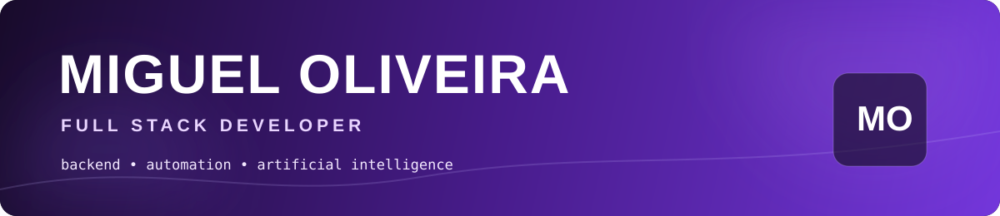

 

**Desenvolvedor Full Stack** · Backend, APIs, Automação e IA aplicada
 
Taubaté, SP · Análise e Desenvolvimento de Sistemas

 

 

## Sobre

Construo aplicações web completas, do banco de dados à interface, com foco em **backend, integração de serviços e automação de processos**. Uso inteligência artificial como ferramenta prática: para reduzir trabalho manual, acelerar o acesso à informação e entregar produtos que resolvem problemas reais.

- **Atuação:** desenvolvimento web, APIs REST, modelagem de dados e automações
- **Explorando:** arquitetura de sistemas, IA generativa e cloud (AWS Cloud Foundations)
- **Em construção:** PersonalHub, GSPlan e Vyzor

 

## Stack

| Área | Tecnologias |
| :-- | :-- |
| **Linguagens** | Python · JavaScript · TypeScript · C# · SQL |
| **Front-end** | HTML · CSS · React · Vue |
| **Back-end & Dados** | APIs REST · MySQL · Supabase |
| **IA & Automação** | n8n · Gemini · Groq |
| **Ferramentas & Deploy** | Git · GitHub Actions · Vercel · AWS · Linux |

 

## Projetos em destaque

<table>
<tr>
<td width="50%" valign="top">

### PersonalHub
Ecossistema pessoal que centraliza finanças, estudos, tarefas e IA em uma única experiência.

`Web` `Produto` `IA` `Automação`

[**Acessar →**](https://www.personalhub.sbs/)

</td>
<td width="50%" valign="top">

### GSPlan
Plataforma de gestão e acompanhamento patrimonial, com foco em organização e visualização clara de dados financeiros.

`Finanças` `Dados` `Web`

[**Acessar →**](https://www.gsplan.company/)

</td>
</tr>
<tr>
<td width="50%" valign="top">

### Vyzor
Automação e centralização de dados empresariais com IA, reduzindo tarefas manuais e o tempo de acesso à informação.

`Python` `IA` `Dados`

[**Código →**](https://github.com/miguelsenai2024/Vyzor)

</td>
<td width="50%" valign="top">

### Mini App de Vendas com IA
Mini App para Telegram com validação de identidade, captura de leads e fluxos de venda automatizados.

`n8n` `Supabase` `Gemini` `Groq`

[**Código →**](https://github.com/miguelsenai2024/telegram-miniapp-vendas-ia) · [**Testar →**](https://t.me/theworkshop2026_bot)

</td>
</tr>
</table>

<b>Outros projetos</b>

 

| Projeto | Descrição | Link |
| :-- | :-- | :-- |
| **ScopeMaster** | Gestão de requisitos, propostas e escopo | [Acessar](https://scope-master-alpha.vercel.app/) |
| **ReAlimenta** | Conecta doadores a ONGs para reduzir o desperdício de alimentos | [Código](https://github.com/miguelsenai2024/ReAlimenta-Public) |
| **GitAutomatico** | Utilitário desktop que automatiza o fluxo de trabalho com Git | [Código](https://github.com/miguelsenai2024/GitAutomatico) |
| **Compartilhamento de Tela** | Espelhamento de Android via ADB e scrcpy, por Wi-Fi ou USB | [Código](https://github.com/miguelsenai2024/Compartilhamento-de-tela) |

 

## Atividade

 

## Contato

Aberto a oportunidades, projetos e boas conversas sobre produto, backend e IA.

